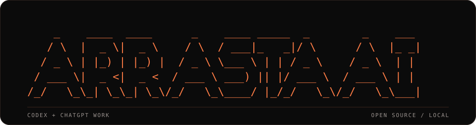
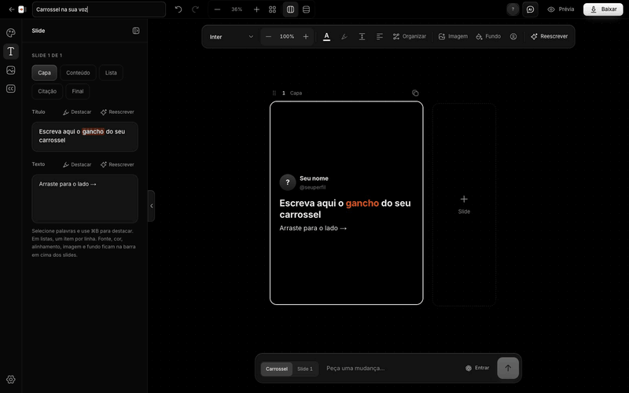
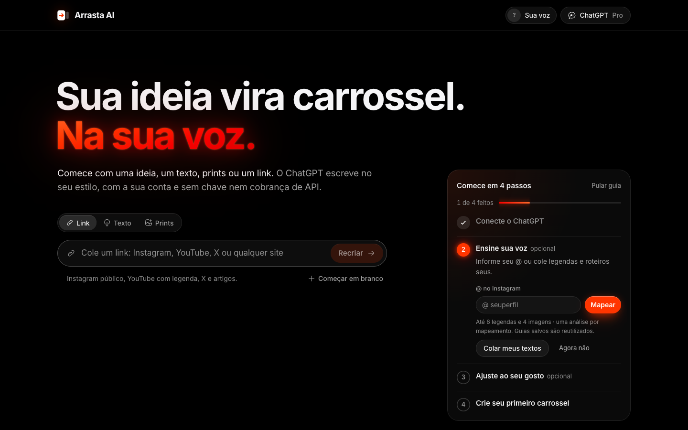
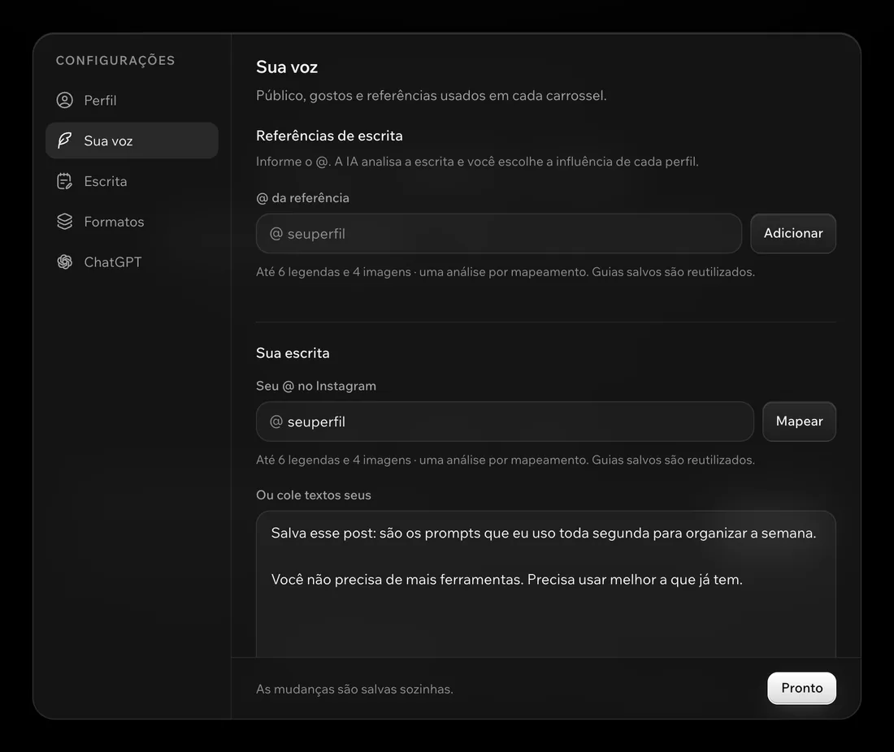
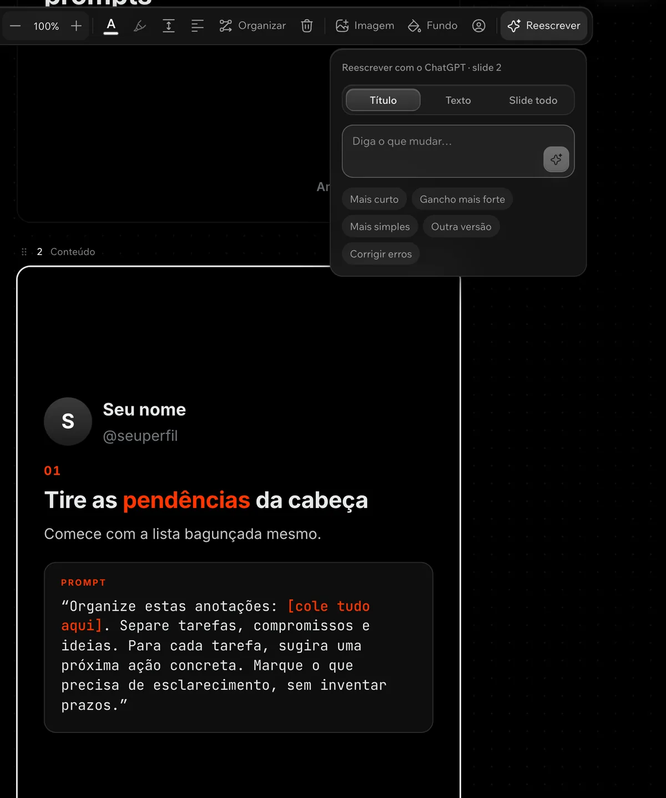
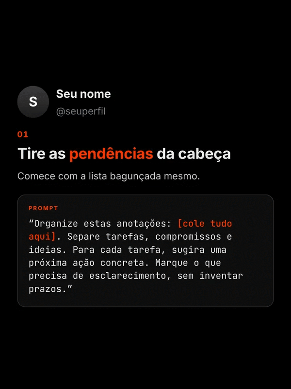
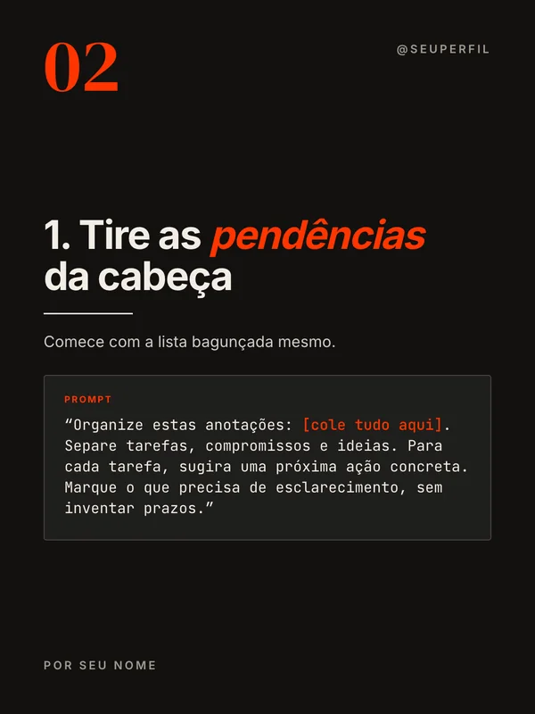
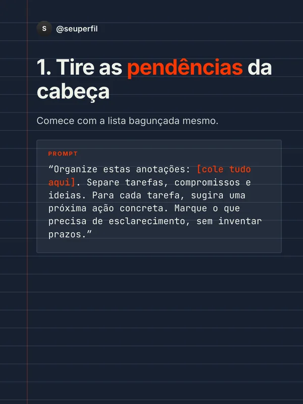
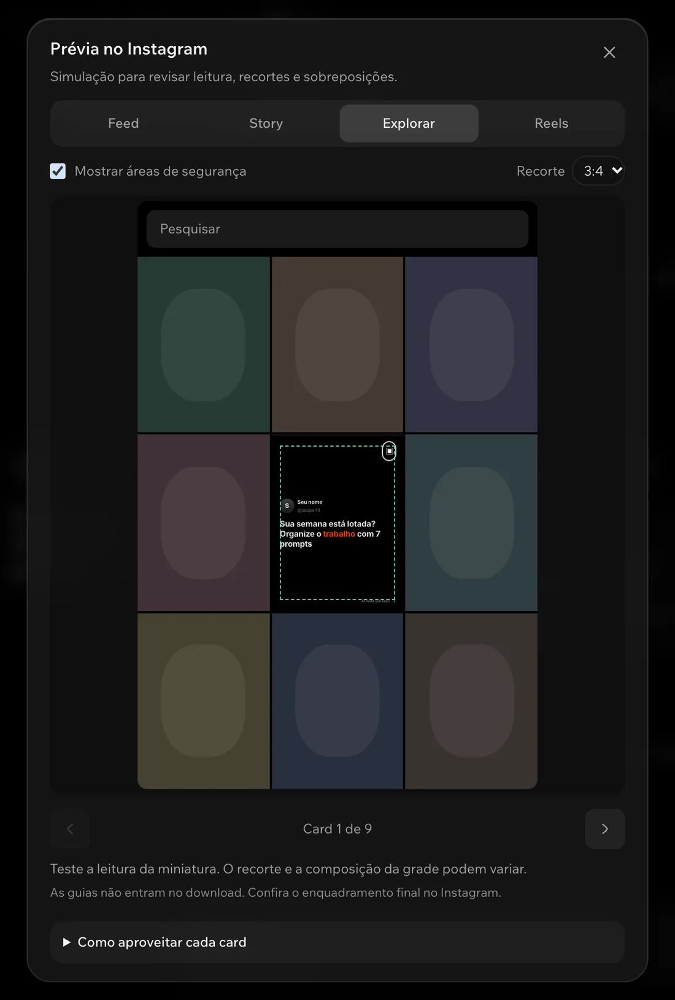
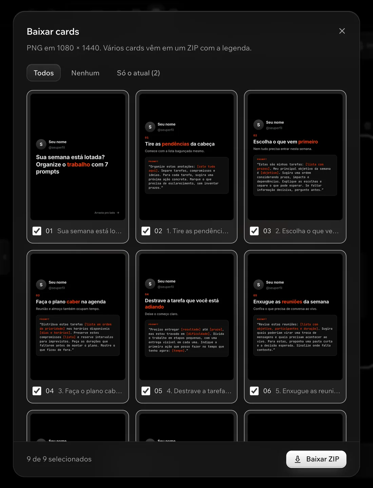

<a name="arrasta-ai"></a>

<p align="center">
  <a href="https://luighi.com/noface/">
    
  </a>
</p>

<h1 align="center">Carrosséis na sua voz.</h1>

<p align="center">Do link ao post, com sua conta do ChatGPT.</p>

<p align="center">
  <a href="LICENSE"></a>
  <a href="docs/GUIA.md#desenvolvimento"></a>
  <a href="https://github.com/luighifeodrippe/arrasta/actions/workflows/ci.yml"></a>
</p>

<p align="center">
  <a href="#começar"><strong>Começar</strong></a> ·
  <a href="https://luighi.com/noface/#tutorial">Tutorial completo</a> ·
  <a href="#instalação-manual">Instalação manual</a>
</p>

<p align="center">
  <picture>
    <source media="(prefers-reduced-motion: reduce)" srcset="docs/midia/editor-demo.png">
    
  </picture>
</p>

<p align="center"><sub>Edição manual, formatação e troca de visual em capturas reais do app.</sub></p>

Transforme uma ideia, um texto, um link ou prints em um carrossel. Configure sua voz e referências, ajuste os cards por conversa ou diretamente no editor e baixe para publicar.

O Arrasta abre uma parte da operação NØFACE: a produção de carrosséis. A estrutura foi construída com Codex; o ChatGPT Work conduz o fluxo, da instalação e da configuração da sua voz ao primeiro carrossel. É gratuito, de código aberto e roda no seu computador.

<p align="center">
  
</p>

## Começar

1. Copie o prompt abaixo e cole no **ChatGPT Work ou no Codex do seu computador**.
2. O agente instala o app e abre o Arrasta no navegador. Entre com sua conta do ChatGPT pelo login oficial.
3. Informe seu perfil e suas referências. Crie o primeiro carrossel e ajuste o resultado antes de exportar.

<details>
<summary><strong>Abrir o prompt completo de instalação</strong></summary>

```text
Quero instalar o Arrasta AI no meu computador e terminar com o meu primeiro carrossel pronto. É um app gratuito e de código aberto: https://github.com/luighifeodrippe/arrasta

O guia de instalação está no próprio repositório, no arquivo AGENTS.md. Leia antes de começar e siga nesta ordem:

1. Confira se você consegue rodar comandos no meu computador. Se estiver numa tarefa na nuvem, me avise e me passe os comandos para eu rodar.
2. Baixe o repositório numa pasta de projetos. Se ele já estiver aqui, use o que existe, sem apagar nada. Confira se o Node.js é 20.9 ou mais novo; se faltar, me diga como instalar no meu sistema.
3. Na pasta do Arrasta, rode npm run setup e espere terminar. Depois rode npm start e abra http://localhost:3737 no meu navegador.
4. No app, eu clico em "Entrar com ChatGPT" e entro com a minha conta. Não me peça senha nem token aqui no chat.
5. Me pergunte o meu @ do Instagram e os @s que eu quero usar como referência de escrita. Use a importação do próprio app para analisar o que for público e configurar a minha voz. Se o Instagram não deixar ler, me peça textos meus ou prints.
6. Depois me pergunte só o que faltar: o objetivo do meu conteúdo, o meu público e o que eu gosto no visual.
7. Faça comigo o primeiro carrossel, revise os cards e exporte os PNGs.

No fim, me diga o endereço do app, o que ficou configurado e onde está o arquivo exportado.
```

</details>

O agente precisa de terminal com acesso ao computador onde o app vai rodar. Se estiver na nuvem, ele pode orientar a [instalação manual](docs/GUIA.md#instalação-manual). Para começar pelo celular, veja o [acesso ao computador](docs/GUIA.md#começar-pelo-celular).

**Sem chave de API nem cobrança de API separada.** O editor usa o acesso ao Codex da sua conta do ChatGPT; valem os modelos, a disponibilidade e os limites do seu plano.

## Do conteúdo ao carrossel

### Comece com o que você já tem

Cole um link acessível do Instagram, YouTube, X ou de um site. Você também pode escrever uma ideia, colar um texto, enviar prints ou começar em branco. Guarde links e textos no banco de conteúdos para transformar em carrosséis depois.



### Instagram e referências

Use seu @, exemplos de textos seus e perfis de referência para configurar a escrita. Escolha o que quer aproveitar de cada referência e ajuste sua influência, seu público e suas preferências.



Se o Instagram bloquear a leitura, você pode colar legendas ou fornecer prints. [Entenda a importação e seus limites](docs/GUIA.md#instagram-e-referências).

### Edite direto ou peça uma mudança

Clique no texto para escrever e formatar. Troque fonte, cor, fundo, imagem e posição dos elementos, com desfazer e refazer. Na conversa, peça uma mudança no carrossel inteiro ou apenas no slide selecionado.


<details>
<summary>Ver as opções de reescrita de um card</summary>



</details>

### O mesmo conteúdo, nove visuais

Os modelos mudam o visual do carrossel inteiro. Personalize fontes, cores e fundos. Escolha também um formato de conteúdo pronto ou escreva suas próprias instruções.

<p align="center">
  <picture>
    <source media="(prefers-reduced-motion: reduce)" srcset="docs/midia/modelos-demo.png">
    
  </picture>
</p>

<p align="center"><sub>Um conteúdo, nove visuais. <a href="https://luighi.com/noface/#modelos">Explore todos os modelos.</a></sub></p>

<details>
<summary>Comparar três modelos lado a lado</summary>

<p>
  
  
  
</p>

</details>

### Confira o enquadramento

Use as guias no editor e as prévias de Feed, Story, Explorar e Reels para conferir o conteúdo antes de publicar.



### Baixe os cards e a legenda

Exporte todos os cards ou apenas uma seleção. Escolha PNG ou ZIP, nas proporções 3:4 ou 4:5. O ZIP também leva a legenda pronta para copiar.



## Instalação manual

Requer **Node.js 20.9+**, internet e uma conta do ChatGPT com acesso ao Codex. Para desenvolver e rodar os testes, use Node.js 24.

```bash
git clone https://github.com/luighifeodrippe/arrasta.git
cd arrasta
npm run setup
npm start
```

Abra [localhost:3737](http://localhost:3737) e escolha **Entrar com ChatGPT**. Mantenha o terminal aberto enquanto usa o app.

[Instalar sem Git no macOS ou no Windows](docs/GUIA.md#instalação-manual) · [Como atualizar](docs/GUIA.md#preparar-e-abrir-nos-dois-sistemas) · [Resolver problemas](docs/GUIA.md#se-algo-der-errado)

## Dados e privacidade

- Projetos, configurações, imagens e login ficam em `data/`, no seu computador. Preserve essa pasta nas atualizações e mantenha-a fora de commits e publicações.
- A geração envia os textos e imagens necessários à OpenAI pelo [Codex CLI oficial](https://github.com/openai/codex). A leitura de links consulta os respectivos serviços.
- O app foi feito para uso pessoal local, em `127.0.0.1`. Rodar localmente não significa funcionar offline.

[Dados e privacidade em detalhe](docs/GUIA.md#dados-e-privacidade) · [Limites de leitura e das prévias](docs/GUIA.md#limites-das-fontes)

## Desenvolvimento e licença

[Comandos de desenvolvimento](docs/GUIA.md#desenvolvimento) · [Como contribuir](CONTRIBUTING.md)

Licença [MIT](LICENSE): você pode usar, modificar e vender, preservando os avisos da licença. Os créditos de componentes e pacotes de terceiros estão em [THIRD_PARTY_NOTICES.md](THIRD_PARTY_NOTICES.md).
