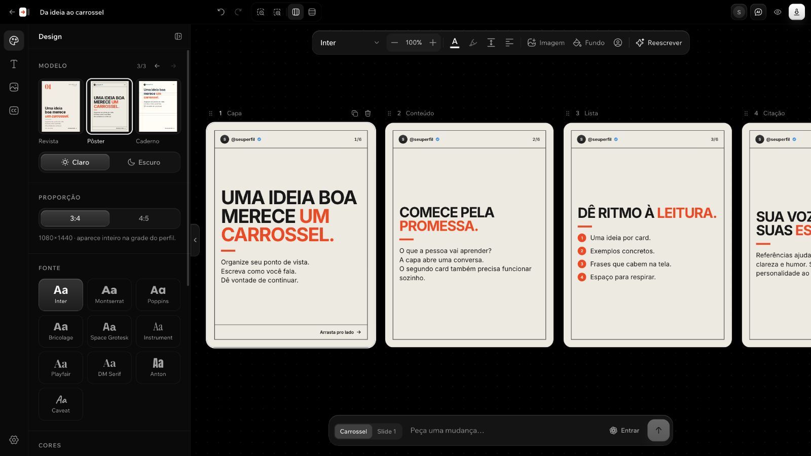

# Arrasta AI

Carrosséis na sua voz, com sua própria conta do ChatGPT.

**Sem chave de API e sem cobrança de API separada.** Ao entrar com ChatGPT, o Arrasta AI usa o acesso ao Codex da sua conta. Modelos, disponibilidade e limites dependem do seu plano; não é uso ilimitado. [Como funciona o login com ChatGPT](https://learn.chatgpt.com/docs/auth).

Crie a partir de ideias, imagens e links acessíveis. Ajuste a escrita à sua voz, edite os cards e exporte para publicar. Código aberto, com licença MIT, para rodar no seu computador.

[Ver demonstração pública](https://luighi.com/arrasta/) · A demonstração apresenta o editor. Para conectar sua conta e usar a IA, instale e rode o app localmente.



## Começar com ChatGPT Work ou Codex

Envie o link deste repositório ao seu agente com este pedido:

> Instale e abra o Arrasta AI no meu computador, usando minha própria conta do ChatGPT, sem configurar chave de API: https://github.com/luighifeodrippe/arrasta. Leia o AGENTS.md e siga o onboarding. Pergunte meu @ do Instagram e os @s que quero usar como referências de escrita; analise as amostras públicas disponíveis e configure minha voz. Depois pergunte apenas meus objetivos, gostos e o que faltar. Se o Instagram bloquear a leitura, me ajude com uma alternativa. Quero terminar com um primeiro carrossel revisado e exportado.

O [AGENTS.md](AGENTS.md) contém as instruções para instalação, entrevista e validação. A execução automática depende de o agente ter terminal e acesso ao computador onde o app vai rodar. No ChatGPT Work, o acesso local depende do app, da conta e das permissões disponíveis; uma tarefa na nuvem não ganha acesso ao computador só porque está aberta no desktop. Sem essas ferramentas, o agente pode conduzir a entrevista e orientar a instalação manual. [Documentação oficial do ChatGPT Work](https://learn.chatgpt.com/docs/enterprise/chatgpt-work-local-security).

## Instalação manual

Precisa de Git, [Node.js](https://nodejs.org) 20.9 ou mais novo e acesso ao Codex pela conta do ChatGPT. Para desenvolver e rodar os testes, use Node.js 24.

```bash
git clone https://github.com/luighifeodrippe/arrasta.git
cd arrasta
npm run setup
npm start
```

Abra [localhost:3737](http://localhost:3737) e clique em **Entrar com ChatGPT**. A própria pessoa conclui o login oficial no navegador. Esse login usa o acesso ao Codex e os limites da sua conta do ChatGPT, sem cobrança de API separada. O login e a geração funcionam na instalação local; a demonstração pública não conecta sua conta.

Para atualizar uma instalação sem alterações no código:

```bash
git pull --ff-only
npm run setup
npm start
```

Encerre a instância anterior antes de iniciar novamente. Preserve a pasta `data/`, onde ficam seus projetos e ajustes.

## O que você pode fazer

- Criar de uma ideia, enviar prints ou usar um link de Instagram, YouTube, X ou artigo, quando a fonte permitir a leitura.
- Analisar seu perfil e referências de escrita pelo @, gerar guias de voz e combinar influências escolhendo o atributo e o peso de cada uma.
- Guardar links e textos em um banco local para transformar em carrosséis depois.
- Usar formatos como storytelling, dicas, passo a passo e mitos e verdades, ou escrever suas próprias instruções.
- Editar textos direto nos cards, formatar trechos, trocar fontes, cores, imagens e proporção; escolher modelos como Perfil, Editorial, Notas, Revista, Pôster e Caderno.
- Pedir alterações na conversa, em um slide ou no carrossel, e restaurar versões anteriores.
- Conferir prévias de Feed, Story, Explorar e Reels, com áreas aproximadas de enquadramento e dicas de composição.
- Baixar todos os cards ou uma seleção, em PNG ou ZIP, preservando a numeração original. O ZIP inclui a legenda.

## Instagram e referências

Informe seu @ ou o @ de uma referência de escrita. O Arrasta AI tenta buscar nome, foto, selo, contagem de seguidores e uma amostra pública: até seis legendas, limitadas a 6.000 caracteres no total, e até quatro imagens dos primeiros cards de carrosséis disponíveis. Com o ChatGPT conectado, faz uma análise breve e monta o guia de voz automaticamente. Depois você ajusta o que quer aproveitar, a influência de cada referência, seus gostos e seu objetivo.

Os resultados ficam em cache local por sete dias. Ao atualizar uma fonte, uma amostra idêntica reutiliza o guia para o mesmo modelo, evitando repetir a análise. Esses limites reduzem a entrada enviada ao modelo; não são uma promessa de quantidade fixa de tokens ou tempo de resposta.

O Instagram pode bloquear a leitura ou entregar uma amostra incompleta. O app informa o que conseguiu importar; sem acesso suficiente, você pode fornecer nome, foto, textos ou prints. Sem login do ChatGPT, os dados públicos disponíveis ainda podem ser importados, mas a análise fica pendente. O importador não usa sua senha do Instagram.

A amostra não representa todo o histórico, métricas privadas ou uma cópia perfeita do estilo. As referências ajudam a compor uma voz própria, aproveitando ritmo, humor, clareza, estrutura ou profundidade.

Use materiais que você pode reutilizar. Revise fatos, citações, marcas e imagens antes de publicar. Reescrever não transfere direitos sobre o material de origem.

## Dados e privacidade

Projetos, imagens, perfil, formatos e ajustes ficam em `data/`. O login do Arrasta AI fica em `data/codex/`; você também pode escolher usar uma conta do Codex já conectada no computador. Para mudar a pasta de dados, configure `ARRASTA_DATA_DIR` antes de iniciar o app.

O app usa o [Codex CLI oficial](https://github.com/openai/codex). Para gerar conteúdo, envia prompts, textos e imagens necessários à OpenAI; a leitura de links consulta os respectivos serviços. Rodar localmente não significa funcionar offline. O Arrasta AI não opera um servidor intermediário próprio.

As tarefas do redator usam uma pasta temporária e o modo de sandbox somente leitura do Codex. Isso restringe gravações, mas não equivale a impedir toda leitura de arquivos. Mantenha o app em `127.0.0.1`: ele foi desenvolvido para uso pessoal local e não oferece isolamento entre contas de uma instalação pública.

Não publique nem anexe `data/`, arquivos `.env`, tokens ou logs de autenticação em issues. Faça backup de seus dados em um local privado.

## Limites das fontes

- **Instagram:** apenas o que estiver acessível publicamente. Se falhar, envie prints ou cole o texto.
- **YouTube:** utiliza legendas disponíveis, não faz uma transcrição própria do áudio. Se não houver legenda acessível, forneça o roteiro.
- **X:** lê um post por vez; para textos longos, pode consultar o [FxTwitter](https://github.com/FixTweet/FxTwitter).
- **Sites:** páginas com login, bloqueios ou conteúdo carregado por JavaScript podem não entregar o texto. A busca na web pode ajudar, sem garantia de recuperar o conteúdo.
- **Prévias:** são aproximações de enquadramento. O Instagram pode mudar cortes e apresentação; confira o post no app antes de publicar.

Carrosséis podem voltar a aparecer no feed começando por outro card, como explica [Adam Mosseri, do Instagram](https://www.instagram.com/reel/DBOeUmTSmIC/). Trate cada card como uma possível entrada para a história; não há garantia de reapresentação, alcance ou distribuição de todos os slides.

## Desenvolvimento

```bash
npm ci
npm run dev
npm test
npm run typecheck
npm run build
```

Veja [como contribuir](CONTRIBUTING.md). Os componentes e pacotes de terceiros mantêm seus créditos em [THIRD_PARTY_NOTICES.md](THIRD_PARTY_NOTICES.md).

## Licença

[MIT](LICENSE) · Luighi Feodrippe.
